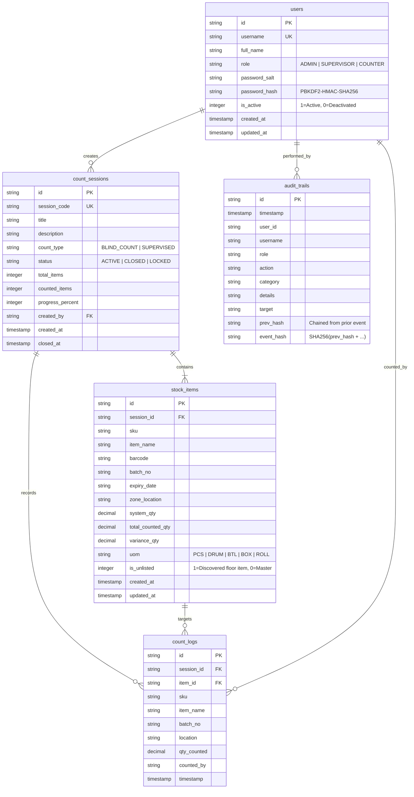

# Lina Manufacturing · Enterprise Stock Verification Cloud
## Complete Production Hosting & Deployment Guide

This guide details how to deploy, host, secure, and maintain the Lina Manufacturing Stock Verification System in production environments (Cloud VPS, Dedicated On-Premise Servers, Docker Containers, or Managed Cloud Platforms).

---

## 1. Relational Database Architecture & Tables

The system operates on an ACID-compliant relational schema implemented in **SQLite / PostgreSQL** ([database/schema.sql](file:///c:/Users/Janagan/Downloads/Stock%20count/database/schema.sql)), backed by the high-performance `node:sqlite` engine with 100% prepared statement parameterization:



### Table Summary:
1. **`users`**: Manages identities, RBAC roles, salted PBKDF2 hashes, and soft-remove deactivation status.
2. **`count_sessions`**: Cycle count sessions with progress tracking, blind count visibility flags, and locking controls.
3. **`stock_items`**: Master product inventory with batch tracking, expiration monitoring, and real-time physical-versus-system variances.
4. **`count_logs`**: Append-only transactional history of every physical barcode scan and manual count submission.
5. **`audit_trails`**: Cryptographically chained tamper-evident ledger ensuring immutable accountability across all operations.

---

## 2. Option A: 1-Click Docker Hosting (Recommended)

Docker provides an isolated, secure, production-hardened container based on Alpine Linux running as a non-privileged user.

### Prerequisites:
* Docker Engine 24+ & Docker Compose v2+ installed on your server.

### Quick Start:
```bash
# 1. Clone or copy project files to your server
cd /opt/lina-stock-count

# 2. Start the container in background mode
docker compose up -d --build

# 3. Check health and live logs
docker compose ps
docker compose logs -f
```

The application is now live at `http://your-server-ip:5173/`.  
Data is persistently stored in `/opt/lina-stock-count/data/` on the host machine.

---

## 3. Option B: Cloud Hosting (AWS, DigitalOcean, Google Cloud Run)

### 3.1 DigitalOcean Droplet / AWS EC2 (Ubuntu 22.04 / 24.04 LTS)
```bash
# Install Node.js 22 LTS
curl -fsSL https://deb.nodesource.com/setup_22.x | sudo -E bash -
sudo apt-get install -y nodejs git

# Setup application directory
sudo mkdir -p /var/www/lina-stock-count
sudo chown -R $USER:$USER /var/www/lina-stock-count
cd /var/www/lina-stock-count

# Copy project files here, then start with PM2 process manager
sudo npm install -g pm2
pm2 start dev-server.js --name "lina-stock-cloud"
pm2 save
pm2 startup
```

### 3.2 Google Cloud Run
Deploying as a stateless container with Cloud Storage or Cloud SQL:
```bash
gcloud run deploy lina-stock-cloud \
  --source . \
  --platform managed \
  --region asia-south1 \
  --allow-unauthenticated \
  --port 5173
```

---

## 4. Production NGINX Reverse Proxy with SSL (HTTPS)

For enterprise security, place NGINX in front of the Node server and configure a free Let's Encrypt TLS certificate:

### 1. Install NGINX & Certbot:
```bash
sudo apt update && sudo apt install -y nginx certbot python3-certbot-nginx
```

### 2. Configure `/etc/nginx/sites-available/stock.linamanufacturing.com`:
```nginx
server {
    server_name stock.linamanufacturing.com;

    # Security Headers
    add_header X-Frame-Options "DENY" always;
    add_header X-Content-Type-Options "nosniff" always;
    add_header Referrer-Policy "strict-origin-when-cross-origin" always;
    add_header Content-Security-Policy "default-src 'self' data: blob: https:; script-src 'self' 'unsafe-inline' 'unsafe-eval' blob:; style-src 'self' 'unsafe-inline' https://fonts.googleapis.com; font-src 'self' data: https://fonts.gstatic.com; img-src 'self' data: blob: https:; connect-src 'self' ws: wss:; object-src 'none';" always;

    # Client Request Limits
    client_max_body_size 30M;

    location / {
        proxy_pass http://127.0.0.1:5173;
        proxy_http_version 1.1;
        proxy_set_header Upgrade $http_upgrade;
        proxy_set_header Connection 'upgrade';
        proxy_set_header Host $host;
        proxy_set_header X-Real-IP $remote_addr;
        proxy_set_header X-Forwarded-For $proxy_add_x_forwarded_for;
        proxy_set_header X-Forwarded-Proto $scheme;
        proxy_cache_bypass $http_upgrade;
    }
}
```

### 3. Enable Site & Obtain SSL Certificate:
```bash
sudo ln -s /etc/nginx/sites-available/stock.linamanufacturing.com /etc/nginx/sites-enabled/
sudo nginx -t && sudo systemctl reload nginx
sudo certbot --nginx -d stock.linamanufacturing.com
```

---

## 5. Automated Database Backups

Create a daily automated snapshot cronjob to back up the SQLite database to a backup volume:

### Create `/usr/local/bin/backup_stock_db.sh`:
```bash
#!/bin/bash
BACKUP_DIR="/var/backups/lina-stock"
TIMESTAMP=$(date +"%Y%m%d_%H%M%S")
mkdir -p "$BACKUP_DIR"

# Perform safe online SQLite backup
sqlite3 /var/www/lina-stock-count/data/stock_count.db ".backup '$BACKUP_DIR/stock_count_$TIMESTAMP.db'"

# Retain last 30 days of snapshots
find "$BACKUP_DIR" -type f -name "*.db" -mtime +30 -delete
```
Make executable and add to crontab:
```bash
chmod +x /usr/local/bin/backup_stock_db.sh
# Runs daily at 2:00 AM
echo "0 2 * * * /usr/local/bin/backup_stock_db.sh" | sudo crontab -
```

---

## 6. System Verification Command

To confirm that the production server is operating securely:
```bash
npm test
```
**Expected Output:**
```
# tests 10
# suites 1
# pass 10
# fail 0
```
This validates PBKDF2 authentication, SQL injection blocking, rate limiting, and blind count enforcement.
