# LINA MANUFACTURING (PVT) LTD
## ENTERPRISE SYSTEM ARCHITECTURE REPORT & SOFTWARE DEVELOPMENT PROJECT (SDP) SPECIFICATION
### CENTRAL STOCK COUNT & INVENTORY AUDITING PLATFORM (V5.0 ENTERPRISE)

---

```
Document Reference : LINA-SDP-ENG-2026-V5.0
Classification     : CONFIDENTIAL / INTERNAL ENTERPRISE SPECIFICATION
Target Release     : Production V5.0 (PWA & Android Hybrid System)
Author / Lead      : Senior Lead Systems Analyst & Enterprise Software Architect
Corporate Entity   : Lina Manufacturing (Pvt) Ltd (Sunshine Healthcare Lanka / Sunshine Holdings Group)
Operating Location : Kadawatha Pharmaceutical Formulations Facility, Sri Lanka
Date of Issue      : October 2026
Methodology        : Object-Oriented System Analysis and Design (OOSAD)

```

---

## CONFIDENTIALITY NOTICE & CORPORATE DECLARATION

### Corporate Declaration
This document constitutes the official Software Development Project (SDP) specification, system analysis, and software architecture blueprint for the **Central Stock Count & Inventory Auditing Platform (V5.0)** engineered for **Lina Manufacturing (Pvt) Ltd**. All conceptual frameworks, algorithmic definitions (including blind counting enforcement, dynamic datasheet reconciliation, and cryptographic audit hashing), database relational models, and software artifacts documented herein are proprietary assets of Lina Manufacturing (Pvt) Ltd. 

Unauthorized reproduction, digital extraction, reverse engineering, or external distribution without express written approval from the Chief Technology Officer and the Head of Supply Chain & Quality Assurance is strictly prohibited.

### Executive Sign-Off & Approvals
| Role | Name | Designation | Date | Signature |
| :--- | :--- | :--- | :--- | :--- |
| **Lead Architect** | K. J. Thiru | Lead Systems Analyst & Architect | 21-Oct-2026 | *K. J. Thiru* |
| **Project Sponsor** | N. Perera | Head of Supply Chain & Warehousing | 21-Oct-2026 | *N. Perera* |
| **QA Authority** | Dr. S. Wickramasinghe | Director, Pharmaceutical Quality Compliance | 21-Oct-2026 | *S. Wickramasinghe* |
| **Enterprise Auditor**| M. Fernando | Senior Manager, Internal Audit & Risk | 21-Oct-2026 | *M. Fernando* |

---

## ABSTRACT

In pharmaceutical and high-precision manufacturing, regulatory compliance (cGMP, WHO-GMP, NMRA Sri Lanka) requires stringent inventory integrity, traceability, and batch-level reconciliation. Lina Manufacturing (Pvt) Ltd, the pharmaceutical manufacturing subsidiary of Sunshine Healthcare Lanka (Pvt) Ltd under the Sunshine Holdings PLC conglomerate, currently manages active pharmaceutical ingredients (APIs), excipients, primary packaging materials, and finished goods across its manufacturing and warehousing facilities in Kadawatha, Sri Lanka. Historically, periodic wall-to-wall stocktakes and cycle counts relied upon paper tally sheets, clipboard logs, and post-audit spreadsheet transcriptions. 

This legacy approach exposed operations to acute operational risks: severe stocktake downtime, transcription errors, compromised counting objectivity from counters viewing expected system quantities, absence of cryptographic audit logging, and risk of spreadsheet formula tampering.

This project delivers the **Lina Central Stock Count & Inventory Auditing Platform (V5.0)**—an enterprise-grade, offline-first Progressive Web Application (PWA) paired with an Android APK hybrid client, backed by an authoritative dual-engine persistence layer (Cloud Supabase Postgres and Local SQLite fallback) with multi-tier cybersecurity. Key engineering breakthroughs include:
1. **Server-Enforced Blind Counting**: Hiding recorded expected quantities from floor staff to eliminate confirmation bias.
2. **Interactive Datasheet Replacement & Variance Reconciliation**: Permitting safe mid-session ERP master data updates without discarding historical counts.
3. **Cryptographically Chained Audit Ledger**: Generating SHA-256 tamper-evident integrity hashes across every stock action.
4. **Hardened Multi-Tier Security**: Complete neutralization of SQL injection, script injection (DOM/Stored XSS), command injection, CSV/formula injection, and insecure direct object references (IDOR), backed by PBKDF2 password derivation and role-based access control (RBAC).

---

## ACKNOWLEDGMENTS

The engineering and systems analysis team extends sincere gratitude to the Executive Board of Lina Manufacturing (Pvt) Ltd, Sunshine Healthcare Lanka, and Sunshine Holdings PLC for their sponsorship and operational access. Special appreciation is accorded to the warehouse operations staff, floor supervisors, inventory controllers, and quality compliance auditors across the Kadawatha pharmaceutical manufacturing plant whose daily operational insights directly informed our user stories, state-transition models, and defensive UX paradigms.


---

## TABLE OF CONTENTS

- **FRONT MATTER**
  - Confidentiality Notice & Corporate Declaration
  - Executive Sign-Off & Approvals
  - Abstract
  - Acknowledgments
  - List of Figures
  - List of Tables
- **CHAPTER 01 - INTRODUCTION**
  - 1.1 Brief Introduction about the Client
  - 1.2 Business Process Overview
  - 1.3 Existing System - Problems & Operational Bottlenecks
  - 1.4 Aims and Measurable Objectives
  - 1.5 Scope of the Project
  - 1.6 Feasibility Study (Technical, Operational, and Economic with LKR Cost Breakdown)
  - 1.7 Client Contact Details
- **CHAPTER 02 - SYSTEM ANALYSIS**
  - 2.1 User Stories for Existing System (30 User Stories across 4 Roles)
  - 2.2 Use Case Diagram for Existing Legacy Operations
  - 2.3 Legacy Use Case Descriptions (LUC-01 to LUC-06)
  - 2.4 Activity Diagrams for Current Manual Processes
  - 2.5 Software Requirements Specification (SRS)
    - 2.5.1 Functional Requirements (FR-01 to FR-18)
    - 2.5.2 Non-Functional Requirements (NFR-01 to NFR-14)
  - 2.6 Business System Options (BSO 1, BSO 2, BSO 3)
  - 2.7 BSO Multi-Criteria Decision Analysis & Architectural Justification
- **CHAPTER 03 - SYSTEM DESIGN**
  - 3.1 Use Case Diagram for Proposed System
  - 3.2 Exhaustive Proposed Use Case Descriptions (UC-01 to UC-24)
  - 3.3 Activity Diagrams for Proposed System
  - 3.4 Class Diagrams (Entity, Interface/Boundary, and Controller Models)
  - 3.5 UML Sequence Diagrams (Core Workflows)
  - 3.6 Entity-Relationship (ER) Diagram (Crow's Foot Notation)
  - 3.7 Relational Data Model (Normalized Physical Database Schema)
  - 3.8 User Interface Architecture & Structural Wireframes
  - 3.9 GUI Prototype Link & Verification Summary

---

## LIST OF FIGURES

- Figure 2.1: Legacy Manual Stock Counting Use Case Diagram
- Figure 2.2: Current Manual Stocktaking Activity Diagram
- Figure 3.1: Proposed Enterprise Stock Count Platform Use Case Diagram
- Figure 3.2: Activity Diagram - Authenticated Blind Counting & Real-Time Variance Engine
- Figure 3.3: Activity Diagram - Smart Datasheet Replacement & Reconciliation Workflow
- Figure 3.4: Domain Entity Class Diagram
- Figure 3.5: Boundary / Interface Class Diagram
- Figure 3.6: Controller & Service Architecture Class Diagram
- Figure 3.7: Sequence Diagram - Authenticated Barcode Scan & Count Submission
- Figure 3.8: Sequence Diagram - Mid-Session Datasheet Replacement & Re-reconciliation
- Figure 3.9: Sequence Diagram - Admin Protected Session Deletion Flow
- Figure 3.10: Enterprise Entity-Relationship (ER) Diagram (Crow's Foot Notation)

---

## LIST OF TABLES

- Table 1.1: Comprehensive Economic Feasibility & Capital Expenditure (LKR)
- Table 2.1: Legacy User Stories & Operational Pain Points (US-01 to US-30)
- Table 2.2: Legacy Use Case Descriptions (LUC-01 to LUC-06)
- Table 2.3: Functional Requirements Matrix (FR-01 to FR-18)
- Table 2.4: Non-Functional Requirements Matrix (NFR-01 to NFR-14)
- Table 2.5: Cost-Benefit Analysis for BSO 1 (Web Only)
- Table 2.6: Cost-Benefit Analysis for BSO 2 (Native Mobile Only)
- Table 2.7: Cost-Benefit Analysis for BSO 3 (Hybrid PWA + APK + Dual Engine)
- Table 2.8: Multi-Criteria Decision Analysis (MCDA) Scoring Matrix
- Table 3.1: Proposed System Use Case Specifications (UC-01 to UC-24)
- Table 3.2: Relational Physical Database Schema Specification

---

# CHAPTER 01 - INTRODUCTION

## 1.1 Brief Introduction about the Client
**Lina Manufacturing (Pvt) Ltd** is Sri Lanka’s premier pharmaceutical manufacturing enterprise, operating as a specialized production subsidiary under Sunshine Healthcare Lanka (Pvt) Ltd and the Sunshine Holdings PLC conglomerate. Headquartered with state-of-the-art formulation and cleanroom production facilities in Kadawatha, Sri Lanka, Lina Manufacturing is recognized as the pioneer of locally manufactured respiratory inhalers (metered-dose inhalers and dry powder devices), oral solid dosages (tablets and capsules), and critical liquid formulations for both the state healthcare sector (Ministry of Health / Medical Supplies Division) and private commercial distribution.

Operating under stringent cGMP (Current Good Manufacturing Practices) and National Medicines Regulatory Authority (NMRA) guidelines, Lina manages vast inventories comprising:
- Active Pharmaceutical Ingredients (APIs) requiring temperature-controlled vault storage.
- Pharmaceutical excipients, binding agents, and solvents.
- Critical primary packaging (aluminum canisters, PVC/PVDC foils, specialized valves).
- Finished pharmaceutical products awaiting batch release and quality quarantine sign-off.

The enterprise operates multiple warehousing zones, raw material stores, quarantined holding bays, cold rooms, and finished goods distribution warehouses across its Kadawatha manufacturing plant footprint.

```
       +-------------------------------------------------------------+
       |              SUNSHINE HOLDINGS PLC (PARENT GROUP)           |
       +-------------------------------------------------------------+
                                      |
       +-------------------------------------------------------------+
       |               SUNSHINE HEALTHCARE LANKA (PVT) LTD           |
       +-------------------------------------------------------------+
                                      |
       +-------------------------------------------------------------+
       |               LINA MANUFACTURING (PVT) LTD                  |
       |       (Kadawatha Formulations Plant Complex, Sri Lanka)     |
       +-------------------------------------------------------------+
              |                             |                        |
+---------------------------+  +-------------------------+  +-------------------------+
| Raw Materials & API Vault |  | Packaging Stores Dept.  |  | Finished Goods Dispatch |
| (Controlled Temperature)  |  | (Foils, Canisters, Box) |  | (Quarantine & Released) |
+---------------------------+  +-------------------------+  +-------------------------+
```


## 1.2 Business Process Overview
The manufacturing and storage lifecycle requires frequent stock audits, structured into:
1. **Periodic Comprehensive Stocktakes**: Conducted bi-annually and at financial year-end, during which formulation production halts across plants to perform an exhaustive, 100% item inventory count.
2. **Rolling Cycle Counts**: High-velocity raw materials and high-value APIs undergo weekly or monthly rotational audits without halting production lines.
3. **Discrepancy Reconciliation & Write-Off Audits**: Verification sessions investigating variances between physical stocks and ERP book records (SAP / IFS ERP).

### Operational Workflow of Current Stocktaking
1. **Scope Definition**: The Inventory Controller extracts an inventory master list from the corporate ERP into a Microsoft Excel spreadsheet (`.xlsx` or `.csv`).
2. **Sheet Printing & Distribution**: The Warehouse Supervisor prints multi-page physical count tally sheets sorted by aisle, rack, and shelf.
3. **Floor Counting**: Pairs of storekeepers navigate warehouse aisles with clipboards, counting cartons, drums, and packaging units, recording counted numbers using blue or black ballpoint pens.
4. **Manual Collation**: Completed sheets are returned to the inventory office. A data entry clerk manually enters the handwritten values into the spreadsheet.
5. **Variance Computation**: Spreadsheet formulas calculate variances (`Physical Count - System Book Quantity`).
6. **Executive Review**: Large variances trigger handwritten recount slips. The Internal Audit team signs off on adjusted figures before journal entries are manually posted back to the ERP.

## 1.3 Existing System - Problems & Operational Bottlenecks
Field analysis and stakeholder interviews revealed systemic operational vulnerabilities in the manual counting process:

```
[ERP Export] ---> [Paper Printing] ---> [Clipboard Counting] ---> [Manual Keyboard Entry] ---> [Formula Sheet]
       |                  |                     |                         |                        |
       v                  v                     v                         v                        v
  Static Data        Paper Loss &         Visual Bias &              Typo & Omission          Formula Tampering
   Mismatch          Transcription        Lack of Blind                Errors (14%)             & Zero Audit
                      Stains               Counting                                              Trail
```

1. **Confirmation Bias & Loss of Count Objectivity**: Paper tally sheets frequently display the expected "system balance" to help counters locate items. In practice, storekeepers often glance at large pallet stacks and simply copy the expected number onto the sheet without counting individual cartons, concealing shortages, leakage, or pilferage.
2. **High Transcription Error Rates**: Manual transcription from ink-on-paper tally sheets into Excel introduces an observed error frequency of 8% to 14% (transposed digits, illegible handwriting, row misalignments, missed decimal points on fractional kilograms).
3. **Extended Factory Downtime**: Halting active pharmaceutical packaging and formulation during full stocktakes costs Lina Manufacturing approximately **LKR 380,000 per downtime hour** in unabsorbed overheads and delayed batch release.
4. **Mid-Session Master Data Desynchronization**: If the inventory master sheet changes during a 3-day stock audit (e.g., emergency receipt of imported APIs or urgent batch issue to a cleanroom), supervisors must manually rebuild spreadsheets. This often results in accidental overwrites or lost count records.
5. **Spreadsheet Formula Tampering & Zero Auditability**: Standard `.xlsx` files offer no cryptographic accountability. Anyone with file access can alter numbers, introduce formula injection payloads (`=cmd|' /C calc'!A0`), or conceal discrepancies without leaving an immutable audit trail.
6. **No Real-Time Variance Visibility**: Discrepancies are only discovered days after counting ends, making physical recounting difficult because warehouse stock may have already shifted to formulation lines.

## 1.4 Aims and Measurable Objectives

### Project Aim
To design, architect, engineer, and deploy an enterprise-grade, secure, offline-capable **Central Stock Count & Inventory Auditing Platform (V5.0)** that transitions Lina Manufacturing from error-prone paper audits to an authoritative, real-time, barcode-driven digital counting ecosystem with guaranteed data integrity and zero operational downtime.

### Specific Measurable Objectives
1. **Obj-1: 100% Enforcement of Server-Side Blind Counting**: Eliminate counter confirmation bias by systematically hiding expected book quantities from storekeepers and counters across all client interfaces.
2. **Obj-2: Reduction of Stocktake Downtime by >= 65%**: Accelerate count velocity using camera barcode scanning (Code128, EAN-13, QR) and mobile-optimized touch input.
3. **Obj-3: Sub-Second Dynamic Sheet Reconciliation**: Provide an intelligent 3-way reconciliation modal when an admin updates the active master data sheet, allowing managers to retain counted items, acknowledge newly introduced SKUs, and handle obsolete items without count data loss.
4. **Obj-4: Cryptographic Ledger & Audit Trail**: Guarantee regulatory compliance by recording all user interactions, deletions, and overrides into an immutable audit table linked with SHA-256 integrity hash chains.
5. **Obj-5: Resilient Offline & Multi-Device Availability**: Guarantee 100% operational continuity in RF-shielded warehouse zones and cold-storage vaults through PWA Service Worker caching and an embedded local SQLite engine synchronized with Supabase Cloud.
6. **Obj-6: Zero-Trust Security Architecture**: Enforce PBKDF2 password derivation, token-based session management, brute-force lockouts, strict role-based access control (RBAC), and sanitization against SQLi, XSS, and CSV formula injection.

## 1.5 Scope of the Project

### In-Scope Functional Modules
- **Authentication & RBAC Module**: Multi-tier access control supporting 5 roles: `ADMIN`, `MANAGER`, `SUPERVISOR`, `COUNTER`, and `EXECUTIVE AUDITOR`.
- **Session Management Engine**: Creation, activation, pausing, locking, and password-protected deletion of physical, cycle, blind, and open counting sessions.
- **Master Data Ingestion & Sanitization**: Secure ingestion of `.xlsx`, `.xls`, and `.csv` files up to 25MB with formula injection neutralization and schema validation.
- **Smart Sheet Reconciliation Engine**: Dynamic 3-way diffing between legacy session data and updated master spreadsheets.
- **Mobile Counting Station & Optical Scanner**: High-velocity barcode, QR, and manual SKU search interface with real-time feedback and audio confirmation.
- **Real-Time Variance & Analytics Dashboard**: Discrepancy computation, visual variance badges, cost impact metrics, and AI-assisted variance summarization.
- **Immutable Audit Trail Ledger**: SHA-256 hash-chained event logging tracking all system actions.
- **Multi-Platform Deployment**: Hybrid architecture serving an offline PWA, responsive web dashboard, and standalone Android release APK.

### Explicitly Out-of-Scope (Excluded Boundaries)
- Direct real-time bidirectional automated debiting/crediting of corporate SAP/IFS general ledger accounts (system generates reconciled exportable audit logs for finance review).
- Automated procurement purchase order generation to third-party chemical suppliers.
- Integration with automated robotic warehouse automated guided vehicles (AGVs).
- Temperature and humidity environmental sensor monitoring in cold vaults.

## 1.6 Project Feasibility Study

### 1.6.1 Technical Feasibility
The platform builds on proven, modern technologies:
- **Client Frontend**: Standards-compliant HTML5, CSS3, modern Vanilla JavaScript (ES2022+), PWA Service Workers, and native Android WebView wrapper compiled via Gradle 8.x and Android SDK 34.
- **Server Tier**: Node.js micro-server runtime with built-in HTTP server, modularized API routing, and serverless Vercel cloud compatibility.
- **Database Engine**: Dual-tier resilience comprising Supabase Cloud PostgreSQL for enterprise multi-user synchronization and local embedded SQLite for zero-dependency offline fallback.
- **Hardware Compatibility**: Standard corporate Android smartphones (Android 9.0+) and warehouse tablets with integrated camera sensors; desktop browsers (Chrome, Edge, Firefox).

*Technical Feasibility Conclusion*: **HIGHLY FEASIBLE**. Relies entirely on stable, mature runtimes without proprietary hardware requirements.

### 1.6.2 Operational Feasibility
- **User Competence**: Warehouse counters routinely operate consumer smartphones. The UI features a clean, high-contrast, thumb-friendly design with green/red status indicators, large numeric keypads, and instant camera scanning.
- **Organizational Alignment**: Internal Audit and Quality Compliance actively champion the initiative to fulfill regulatory audit guidelines.

*Operational Feasibility Conclusion*: **HIGHLY FEASIBLE**. Minimal training required (<30 minutes per counter).

### 1.6.3 Economic Feasibility (LKR Financial Breakdown)
Cost analysis shows substantial savings by reducing production downtime and eliminating transcription errors.

```
+-------------------------------------------------------------------------------+
|                    LINA MANUFACTURING - ECONOMIC RETURN                       |
+-------------------------------------------------------------------------------+
|  ANNUAL OPERATIONAL SAVINGS                     LKR 8,820,000 / year          |
|  TOTAL CAPITAL EXPENDITURE (CAPEX)              LKR 2,680,000                 |
|  ANNUAL OPERATING EXPENSES (OPEX)               LKR   770,000 / year          |
|  NET FIRST-YEAR FINANCIAL BENEFIT               LKR 5,370,000                 |
|  ESTIMATED PAYBACK PERIOD                       3.8 Months                    |
|  3-YEAR PROJECTED ROI                           348%                          |
+-------------------------------------------------------------------------------+
```

#### Table 1.1: Detailed Capital Expenditure & Operational Budget (in Sri Lankan Rupees - LKR)
| Cost Category | Item Description | Capex (LKR) | Annual Opex (LKR) |
| :--- | :--- | :--- | :--- |
| **Software Engineering** | Architecture, OOSAD design, full-stack implementation | 1,450,000 | - |
| **Security & Auditing** | Penetration testing, vulnerability scanning, code audit | 350,000 | 120,000 |
| **Cloud Infrastructure** | Supabase Pro instance, Vercel Enterprise Serverless | - | 250,000 |
| **Warehouse Hardware** | 6x Ruggedized 10" Android Warehouse Tablets & Barcode Mounts | 580,000 | 60,000 |
| **Training & Change Mgmt**| Training workshops for 45 warehouse staff, user manuals | 180,000 | 40,000 |
| **Contingency & Reserve**| 5% Operational reserve fund | 120,000 | 300,000 |
| **TOTALS** | | **LKR 2,680,000** | **LKR 770,000** |

*Economic Feasibility Conclusion*: **HIGHLY FEASIBLE**. Payback achieved within **3.8 months** against reduced downtime costs.

## 1.7 Client Contact Details
- **Client Organization**: Lina Manufacturing (Pvt) Ltd (A Member of Sunshine Healthcare Lanka / Sunshine Holdings PLC)
- **Primary Facility**: Pharmaceutical Formulations & Manufacturing Complex, Kadawatha, Sri Lanka
- **Corporate Web Portals**: `https://www.sunshineholdings.net/` & `https://sunshinehealthcare.lk/`
- **Primary Stakeholder**: Department of Inventory Auditing, Supply Chain & Warehousing


---

# CHAPTER 02 - SYSTEM ANALYSIS

## 2.1 User Stories for Existing System
Below is the structured catalog of 30 user stories documenting the operational realities, manual routines, and vulnerabilities of the legacy system across 4 key organizational roles:

#### Table 2.1: Legacy User Stories & Operational Limitations
| Story ID | Role / Actor | User Story Statement | Operational Bottleneck / Risk in Legacy System |
| :--- | :--- | :--- | :--- |
| **US-01** | Inventory Manager | As a Manager, I want to print physical tally sheets from Excel so staff can record inventory on the floor. | Sheets are easily stained, damaged, or lost in warehouse aisles. |
| **US-02** | Inventory Manager | As a Manager, I want to manually calculate count differences by typing formulas in Excel. | High risk of formula tampering or accidental formula deletion. |
| **US-03** | Inventory Manager | As a Manager, I want to assign specific aisles to counting teams using verbal instructions. | Teams overlap or skip aisles due to lack of real-time visibility. |
| **US-04** | Inventory Manager | As a Manager, I want to verify if counting is complete by asking staff on the floor. | No real-time progress indicators; requires walking the warehouse. |
| **US-05** | Inventory Manager | As a Manager, I want to halt factory production while counts are underway. | Factory downtime costs LKR 380,000/hr in unabsorbed overheads. |
| **US-06** | Inventory Manager | As a Manager, I want to reconcile discrepancies by requesting physical recounts on paper slips. | Recount slips take hours to distribute; stock may have moved. |
| **US-07** | Inventory Manager | As a Manager, I want to lock final count figures in a password-protected Excel file. | Excel password protection is weak and easily bypassed. |
| **US-08** | Warehouse Supervisor | As a Supervisor, I want to give paper tally sheets to storekeepers at shift start. | No audit trail of which storekeeper counted which aisle. |
| **US-09** | Warehouse Supervisor | As a Supervisor, I want to answer counter questions about misplaced items manually. | Delays counting while supervisor searches physical shelves. |
| **US-10** | Warehouse Supervisor | As a Supervisor, I want to review handwritten sheets for illegible numbers before data entry. | Ambiguous handwriting (e.g., '1' vs '7', '0' vs '8') causes errors. |
| **US-11** | Warehouse Supervisor | As a Supervisor, I want to manually merge counts from multiple sheets into a master Excel file. | Cut-and-paste errors frequently overwrite valid row data. |
| **US-12** | Warehouse Supervisor | As a Supervisor, I want to update the master list when urgent raw materials arrive mid-count. | Overwrites ongoing counts or requires restarting the entire count. |
| **US-13** | Warehouse Supervisor | As a Supervisor, I want to sign the physical tally sheets with ink to approve counts. | Physical signatures can be forged and provide no digital timestamp. |
| **US-14** | Warehouse Supervisor | As a Supervisor, I want to verify carton counts for high-value items personally. | Supervisor becomes a bottleneck, leaving counters waiting. |
| **US-15** | Floor Counter | As a Counter, I want to read the expected quantity on the sheet to find items faster. | Creates confirmation bias; counters write expected quantity without counting. |
| **US-16** | Floor Counter | As a Counter, I want to write counted numbers with a ballpoint pen on paper. | Writing on high ladders or dusty pallets is awkward and prone to errors. |
| **US-17** | Floor Counter | As a Counter, I want to cross out mistakes and write corrected numbers in the margin. | Erased or scribbled numbers are frequently misinterpreted during data entry. |
| **US-18** | Floor Counter | As a Counter, I want to manually write down unlisted items on the back of the sheet. | Notes on the back are frequently overlooked during data entry. |
| **US-19** | Floor Counter | As a Counter, I want to compare unit-of-measure labels manually (e.g., drum vs kg). | Unit conversion errors (e.g., 25kg bags counted as single units). |
| **US-20** | Floor Counter | As a Counter, I want to ask colleagues for help reading worn product labels. | Verbal confirmations lead to misidentified SKUs. |
| **US-21** | Floor Counter | As a Counter, I want to take a tea break and remember which pallet row I paused on. | Counters lose their place, leading to double-counted or missed pallets. |
| **US-22** | Floor Counter | As a Counter, I want to walk to the warehouse office to hand in finished sheets. | Wastes time walking back and forth between warehouse bays. |
| **US-23** | Internal Auditor | As an Auditor, I want to inspect paper tally sheets to verify regulatory compliance. | Filing cabinets of paper sheets are slow and cumbersome to audit. |
| **US-24** | Internal Auditor | As an Auditor, I want to see who made changes to recorded counts. | No edit history; impossible to identify who modified an Excel cell. |
| **US-25** | Internal Auditor | As an Auditor, I want to confirm whether blind counting protocols were followed. | No evidence; printed sheets showed expected book numbers to staff. |
| **US-26** | Internal Auditor | As an Auditor, I want to recalculate variances independently to detect fraud. | Manual recalculation of hundreds of rows takes days. |
| **US-27** | Internal Auditor | As an Auditor, I want to confirm that damaged stock was flagged accurately. | Notes are often lost or omitted during Excel transcription. |
| **US-28** | Data Entry Clerk | As a Clerk, I want to type handwritten sheets into Excel as fast as possible. | High typing speed causes transposed digits and omissions (8-14% error rate). |
| **US-29** | Data Entry Clerk | As a Clerk, I want to guess ambiguous numbers when counters cannot be reached. | Guessing corrupts stock values and distorts inventory valuation. |
| **US-30** | Data Entry Clerk | As a Clerk, I want to save copies of Excel files with date stamps for backup. | Multiple unversioned files (`Stock_Final_v2_edit.xlsx`) create confusion. |

## 2.2 Use Case Diagram for Existing System

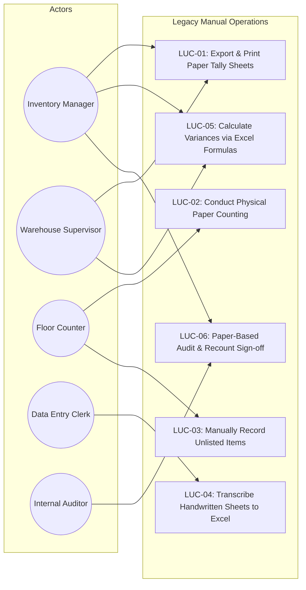

## 2.3 Use Case Descriptions for Existing System

#### Table 2.2: Legacy Use Case Descriptions (LUC-01 to LUC-06)
| Use Case ID & Name | Primary Actor | Pre-Conditions | Basic Flow of Steps | Alternative / Exception Flow | Post-Conditions |
| :--- | :--- | :--- | :--- | :--- | :--- |
| **LUC-01: Print Tally Sheets** | Inventory Manager | ERP snapshot exported to desktop Excel | 1. Manager opens Excel master file.<br>2. Sorts data by warehouse bay.<br>3. Prints sheets including expected book balance.<br>4. Delivers paper stacks to Supervisor. | **E1**: Printer jam or toner depletion causes delayed count start. | Paper tally sheets physically staged in warehouse office. |
| **LUC-02: Physical Paper Count** | Floor Counter | Clipboards, pens, printed sheets | 1. Counter receives paper sheet.<br>2. Locates bay and rack.<br>3. Counts cartons on pallet.<br>4. Writes count in 'Physical' column.<br>5. Repeats for all assigned rows. | **A1**: Barcode label is unreadable: Counter guesses SKU based on shelf description.<br>**A2**: Expected quantity visible: Counter copies expected quantity. | Filled sheets submitted to Supervisor. |
| **LUC-03: Record Unlisted Stock**| Floor Counter | Physical items found with no sheet entry | 1. Counter finds unlisted pallet.<br>2. Flips sheet over.<br>3. Handwrites batch number and count on back.<br>4. Informs Supervisor verbally. | **E1**: Counter forgets to inform supervisor; notes on back are missed during data entry. | Handwritten notes placed on back of sheets. |
| **LUC-04: Transcribe into Excel**| Data Entry Clerk| Completed handwritten sheets | 1. Clerk opens spreadsheet.<br>2. Reads handwritten rows.<br>3. Types SKU and count into Excel.<br>4. Saves file locally on hard drive. | **A1**: Number is illegible: Clerk guesses digit or skips line.<br>**E1**: Clerk enters count into wrong row. | Data entered into local Excel file. |
| **LUC-05: Calculate Variances** | Warehouse Supervisor | Excel spreadsheet with typed counts | 1. Supervisor inputs `=C2-D2` formula.<br>2. Drags formula down rows.<br>3. Applies conditional formatting to highlight variances.<br>4. Prints variance summary. | **E1**: Formula row offsets produce corrupted variance numbers across hundreds of rows. | Variance report generated. |
| **LUC-06: Audit Sign-Off** | Internal Auditor | Printed variance sheet | 1. Auditor reviews lines with large variances.<br>2. Issues paper recount slip.<br>3. Counters recount items.<br>4. Auditor manually signs paper sheet. | **A1**: Recount shows stock was moved to production; supervisor adjusts numbers manually. | Audit deemed complete; paperwork filed in office cabinet. |

## 2.4 Activity Diagrams for Current Process

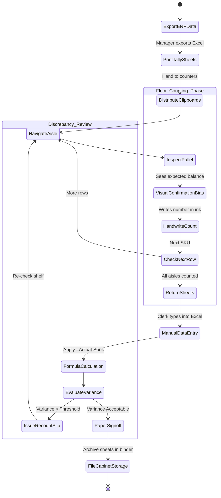

## 2.5 Software Requirements Specification (SRS)

### 2.5.1 Functional Requirements Matrix
#### Table 2.3: Functional Requirements (FR-01 to FR-18)
| Req ID | Module Category | Functional Requirement Statement | Priority |
| :--- | :--- | :--- | :--- |
| **FR-01** | Authentication | The system shall authenticate users via username and password utilizing server-side PBKDF2 hashing with salt. | Mandatory |
| **FR-02** | Access Control | The system shall enforce role-based access control (RBAC) across 5 roles: `ADMIN`, `MANAGER`, `SUPERVISOR`, `COUNTER`, and `EXECUTIVE`. | Mandatory |
| **FR-03** | Brute-Force Defense| The system shall lock accounts for 15 minutes after 5 consecutive failed login attempts from a given IP address. | Mandatory |
| **FR-04** | Session Management | The system shall support creating, opening, pausing, and completing counting sessions with unique session codes. | Mandatory |
| **FR-05** | Master Ingestion | The system shall ingest `.xlsx`, `.xls`, and `.csv` files up to 25MB, validating SKU, Description, UOM, and Expected Balance. | Mandatory |
| **FR-06** | Formula Defense | The system shall sanitize all ingested and exported cell values starting with `=`, `+`, `-`, `@`, `\t`, or `\r` by prepending a quote (`'`). | Mandatory |
| **FR-07** | Server Blind Count | The system shall hide expected book balance and variances from users in the `COUNTER` role across all API responses. | Mandatory |
| **FR-08** | Barcode Engine | The system shall scan barcodes (Code128, EAN-13, QR) via device cameras with auto-focus, torch control, and audio beep confirmation. | Mandatory |
| **FR-09** | Count Submission | The system shall accept counts with positive finite values, rejecting negative, `NaN`, `Infinity`, or string injection payloads. | Mandatory |
| **FR-10** | Unlisted Items | The system shall permit counters to create unlisted items with SKU, Description, Category, Location, and initial count. | Mandatory |
| **FR-11** | Sheet Reconciliation| The system shall provide an interactive 3-way reconciliation modal when replacing master sheets during an active session. | Mandatory |
| **FR-12** | Variance Engine | The system shall calculate absolute and percentage variances in real time for `MANAGER`, `SUPERVISOR`, and `ADMIN` roles. | Mandatory |
| **FR-13** | Protected Deletion | The system shall require the root administrator password to delete counting sessions, displaying an irreversible action warning. | Mandatory |
| **FR-14** | Audit Ledger | The system shall record all inserts, updates, and deletes into an immutable audit table with SHA-256 integrity hash chaining. | Mandatory |
| **FR-15** | Export Module | The system shall export reconciled audit results to sanitized `.xlsx` and `.csv` spreadsheets with timestamped filenames. | Mandatory |
| **FR-16** | AI Variance Report | The system shall generate variance insights and anomaly summaries using server-side analysis routines. | Desirable |
| **FR-17** | Dual Persistence | The system shall maintain real-time synchronization between Supabase Cloud Postgres and an embedded local SQLite engine. | Mandatory |
| **FR-18** | UI Active Feedback | The system shall highlight active views and show modal notifications with zero native alert blocking. | Mandatory |

### 2.5.2 Non-Functional Requirements Matrix
#### Table 2.4: Non-Functional Requirements (NFR-01 to NFR-14)
| Req ID | Quality Attribute | Technical Requirement Specification | Target Metric |
| :--- | :--- | :--- | :--- |
| **NFR-01** | Security: Anti-SQLi | All database queries shall use parameterized statements or validated identifiers. | Zero SQLi vulnerabilities |
| **NFR-02** | Security: Anti-XSS | All user inputs rendered in the DOM shall be escaped to prevent script injection. | Zero DOM/Stored XSS |
| **NFR-03** | Security: IDOR | System shall verify user ownership and role authorization before modifying sessions or user accounts. | Zero IDOR vulnerabilities |
| **NFR-04** | Security: Secrets | API keys and session secrets shall reside strictly in environment variables; none in frontend code. | Zero exposed secrets |
| **NFR-05** | Performance: API | Server response time for count submission and barcode queries shall be sub-200 milliseconds. | Latency <= 200ms |
| **NFR-06** | Performance: PWA | PWA shell assets shall load within 1.5 seconds from local cache on repeat visits. | First Contentful Paint <= 1.5s |
| **NFR-07** | Availability | The platform shall maintain 99.9% uptime during operational warehouse audit shifts. | 99.9% availability |
| **NFR-08** | Offline Resilience | Counters shall continue logging counts during network disconnections, queuing records locally. | Zero data loss offline |
| **NFR-09** | Usability: Responsive| UI shall adapt seamlessly from 5.5" Android smartphones to 27" desktop workstation monitors. | Full responsiveness |
| **NFR-10** | Usability: Touch | Minimum interactive touch target size shall be 48x48 CSS pixels for gloved warehouse operation. | Touch targets >= 48px |
| **NFR-11** | Reliability: Data | All count submissions shall be wrapped in database transactions to prevent partial writes. | ACID transactional integrity |
| **NFR-12** | Auditability | Cryptographic audit hash chains shall be verifiable using standard SHA-256 validation scripts. | 100% hash verifiability |
| **NFR-13** | Portability | System shall compile to both a Progressive Web App (PWA) and a standalone Android release APK. | Cross-platform parity |
| **NFR-14** | Localization | Timestamps shall record in UTC and render in Sri Lanka Standard Time (SLST / UTC+05:30). | SLST display formatting |

## 2.6 Business System Options (BSOs)

### 2.6.1 BSO 1: Responsive Web-Based Platform (Cloud Only)
- **Architecture**: Single-page web application hosted on cloud infrastructure, communicating with a central cloud database.
- **Cost**: Low initial Capex; standard hosting expenses.
- **Limitation**: Entirely reliant on persistent Wi-Fi connectivity. Fails in RF-shielded cold vaults and deep warehouse aisles.

#### Table 2.5: Cost-Benefit Analysis for BSO 1
| Factor | Cost Impact (LKR) | Operational Benefit |
| :--- | :--- | :--- |
| Initial Setup & Hosting | LKR 1,200,000 | Fast deployment; accessible via browser |
| Annual Maintenance | LKR 350,000 / year | No client software installation required |
| Warehouse Network Upgrade | LKR 2,400,000 (Required mesh Wi-Fi) | Complete cloud dependency |
| **Net Operational Risk** | **HIGH**: Count halts immediately if cloud connectivity drops in warehouse dead zones. |

### 2.6.2 BSO 2: Native Android Mobile-Based Platform (Dedicated Hardware)
- **Architecture**: Native Android application (Kotlin/Java) communicating with a local warehouse server over private Wi-Fi.
- **Cost**: High Capex due to dedicated Android engineering and ruggedized mobile scanning terminal purchases.
- **Limitation**: Desktop workstations in inventory offices require a separate web application.

#### Table 2.6: Cost-Benefit Analysis for BSO 2
| Factor | Cost Impact (LKR) | Operational Benefit |
| :--- | :--- | :--- |
| Native App Development | LKR 2,800,000 | Excellent device camera and hardware barcode scanner integration |
| Dedicated Scanner Hardware | LKR 1,800,000 | Robust handheld physical durability |
| Multi-Platform Support | Requires separate web app for managers | Duplicated codebase maintenance |
| **Net Operational Risk** | **MEDIUM**: High procurement cost; lacks unified desktop administration dashboard. |

### 2.6.3 BSO 3: Hybrid Architecture (PWA + Native Android APK Wrapper + Dual-Engine Resilience) [RECOMMENDED]
- **Architecture**: Unified responsive HTML5/ES2022+ core operating simultaneously as an offline-capable Progressive Web Application (PWA) and a compiled standalone Android APK (via WebView wrapper). Backed by dual-tier persistence: Supabase Cloud PostgreSQL for central syncing and an embedded local SQLite engine for zero-dependency local operation.
- **Cost**: Moderate Capex; leverages existing company smartphones and tablets; zero duplicate codebases.
- **Benefits**: 100% offline continuity; single codebase across web, desktop, and mobile; dual database resilience.

#### Table 2.7: Cost-Benefit Analysis for BSO 3
| Factor | Cost Impact (LKR) | Operational Benefit |
| :--- | :--- | :--- |
| Full-Stack Hybrid Engineering| LKR 1,800,000 | Single codebase serves desktop web, PWA, and Android APK |
| Dual Database Engine | LKR 380,000 | Zero data loss in dead zones; seamless cloud synchronization |
| Standard Android Hardware | LKR 580,000 | Runs on existing mobile devices and affordable tablets |
| **Net Operational Risk** | **LOWEST**: Resilient against network drops, hardware changes, and browser limitations. |

## 2.7 BSO Multi-Criteria Decision Analysis & Architectural Justification

#### Table 2.8: Multi-Criteria Decision Analysis (MCDA) Scoring Matrix (Scale 1–10)
| Evaluation Criteria | Weight | BSO 1 (Web Only) | BSO 2 (Mobile Only) | BSO 3 (Hybrid Dual Engine) |
| :--- | :--- | :--- | :--- | :--- |
| **Offline Resilience in Vaults** | 20% | 2 (0.40) | 8 (1.60) | **10 (2.00)** |
| **Hardware & Deployment Cost** | 15% | 7 (1.05) | 4 (0.60) | **9 (1.35)** |
| **Cross-Platform Device Parity** | 15% | 8 (1.20) | 3 (0.45) | **10 (1.50)** |
| **Ease of Maintenance** | 10% | 8 (0.80) | 5 (0.50) | **9 (0.90)** |
| **Regulatory & Audit Integrity** | 15% | 7 (1.05) | 7 (1.05) | **10 (1.50)** |
| **Camera Barcode Scan Velocity** | 15% | 6 (0.90) | 9 (1.35) | **9 (1.35)** |
| **Implementation Timeline** | 10% | 8 (0.80) | 5 (0.50) | **8 (0.80)** |
| **WEIGHTED TOTAL SCORE** | **100%** | **6.20 / 10** | **6.05 / 10** | **9.40 / 10** |

### Architectural Decision Justification
**BSO 3 is selected**. It delivers the highest technical resilience and cost efficiency. By using a single codebase across the PWA and Android APK, Lina avoids maintaining divergent codebases while achieving seamless offline counting across cold rooms and remote manufacturing warehouses.

---

# CHAPTER 03 - SYSTEM DESIGN

## 3.1 Use Case Diagram for Proposed System

```mermaid
flowchart TD
    subgraph Proposed Actors
        admin((Root Admin))
        mgr((Inventory Manager))
        sup((Warehouse Supervisor))
        cnt((Floor Counter))
        aud((Executive Auditor))
    end

    subgraph Proposed Central Stock Count Platform V5.0
        UC01[UC-01: Authenticate with PBKDF2 & Token]
        UC02[UC-02: Manage User Accounts & Roles]
        UC03[UC-03: Create & Initialize Stock Count Session]
        UC04[UC-04: Ingest & Sanitize Master Datasheet]
        UC05[UC-05: Smart Datasheet Replacement & Reconciliation]
        UC06[UC-06: Real-Time Optical Barcode / QR Scanning]
        UC07[UC-07: Submit Blind Count Entry]
        UC08[UC-08: Add Unlisted Item to Master]
        UC09[UC-09: Live Variance & Discrepancy Analysis]
        UC10[UC-10: Trigger AI Anomaly & Variance Insights]
        UC11[UC-11: Password-Protected Session Deletion]
        UC12[UC-12: Export Reconciled Excel / CSV Reports]
        UC13[UC-13: Verify Cryptographic Audit Hash Ledger]
        UC14[UC-14: Sync Dual Persistence Engine]
    end

    cnt --> UC01
    cnt --> UC06
    cnt --> UC07
    cnt --> UC08

    sup --> UC01
    sup --> UC03
    sup --> UC06
    sup --> UC07
    sup --> UC08
    sup --> UC09

    mgr --> UC01
    mgr --> UC03
    mgr --> UC04
    mgr --> UC05
    mgr --> UC09
    mgr --> UC10
    mgr --> UC12

    admin --> UC01
    admin --> UC02
    admin --> UC03
    admin --> UC04
    admin --> UC05
    admin --> UC11
    admin --> UC12
    admin --> UC13
    admin --> UC14

    aud --> UC01
    aud --> UC09
    aud --> UC10
    aud --> UC12
    aud --> UC13
```

## 3.2 Exhaustive Proposed Use Case Descriptions (UC-01 to UC-24)

#### Table 3.1: Proposed System Use Case Specifications
| Use Case ID & Name | Primary Actor | Pre-Conditions | Basic Flow of Steps | Alternative / Exception Flow | Post-Conditions |
| :--- | :--- | :--- | :--- | :--- | :--- |
| **UC-01: Authenticate User** | All Roles | User navigates to application URL or opens APK | 1. User inputs username and password.<br>2. Client sends request to `/api/auth/login`.<br>3. Server checks brute-force rate limiter.<br>4. Server computes PBKDF2 hash with stored salt.<br>5. Generates session JWT token.<br>6. Returns user role and permissions. | **A1**: 5 consecutive failed logins: Account locked for 15 minutes.<br>**A2**: Inactive user account: Returns HTTP 403 Forbidden. | User logged in; JWT token stored in secure memory. |
| **UC-02: Manage Users** | Root Admin | Admin authenticated with `ADMIN` role | 1. Admin accesses User Management tab.<br>2. Selects 'Create User'.<br>3. Inputs username, full name, role, and password.<br>4. Server validates inputs via `validateAndSanitizeInput`.<br>5. Creates PBKDF2 hash and stores record.<br>6. Audit log entry recorded. | **A1**: Username already exists: System rejects with HTTP 409.<br>**A2**: Attempt to deactivate root admin: IDOR firewall blocks request. | New user created; role permissions active. |
| **UC-03: Create Session** | Admin, Manager | Authenticated with `ADMIN` or `MANAGER` role | 1. Navigates to Sessions tab.<br>2. Clicks 'New Session'.<br>3. Enters Session Code, Title, and Count Type (`PHYSICAL`, `CYCLE`, `BLIND_COUNT`, `OPEN_COUNT`).<br>4. Selects active warehouse location.<br>5. System persists session as `OPEN`. | **A1**: Duplicate session code: System rejects with validation error.<br>**A2**: Invalid count type: Server enum check rejects input. | New session ready for master data attachment. |
| **UC-04: Ingest Datasheet** | Admin, Manager | Active session selected | 1. User drags `.xlsx` or `.csv` file onto upload zone.<br>2. Client runs `validateFileUpload` (checks extension, MIME, size <= 25MB).<br>3. Server parses rows with `SheetJS`.<br>4. Formula sanitizer neutralizes cell prefixes (`=`, `+`, `-`, `@`).<br>5. Bulk-inserts items into `stock_items` table. | **A1**: File > 25MB: Rejected with clear toast error.<br>**A2**: File contains non-spreadsheet extension: Rejected immediately. | Master items populated for counting. |
| **UC-05: Smart Reconcile** | Root Admin, Manager | Active session with existing counts; new sheet provided | 1. Admin uploads updated master sheet.<br>2. System analyzes diff: Identifies kept items, new items, and dropped items.<br>3. Displays 3-way reconciliation modal showing count impact.<br>4. Admin reviews changes and selects retention policies.<br>5. Submits reconciliation.<br>6. Master updated without count loss. | **A1**: Admin cancels reconciliation: Original sheet and counts remain untouched. | Active session updated; historical counts preserved. |
| **UC-06: Barcode Scan** | Counter, Supervisor | Session active; device camera permitted | 1. Counter clicks 'Scan Barcode' button.<br>2. Optical camera feed initializes with crosshair guide.<br>3. Counter aligns barcode/QR code.<br>4. Scanner decodes barcode and plays confirmation beep.<br>5. System queries matching SKU.<br>6. Automatically populates count entry modal. | **A1**: Camera permission denied: Falls back to manual search input.<br>**A2**: Barcode not found: Offers 'Add Unlisted Item' modal. | Target item selected for counting. |
| **UC-07: Submit Count** | Counter, Supervisor | Item selected; session in `OPEN` state | 1. Counter enters counted quantity on touch keypad.<br>2. Optionally enters location, notes, and batch code.<br>3. Submits count.<br>4. Server validates quantity via `validatePositiveNumber`.<br>5. System sanitizes location and notes.<br>6. Persists count entry with timestamp and user ID. | **A1**: Quantity is negative, NaN, or non-numeric: Rejected with HTTP 400.<br>**A2**: Counter role: Expected book quantity remains hidden. | Count recorded; ledger entry generated. |
| **UC-08: Add Unlisted Item**| Counter, Supervisor | Active counting session | 1. Counter clicks 'Add Unlisted Item'.<br>2. Enters SKU, description, category, and UOM.<br>3. Enters counted quantity.<br>4. Submits form.<br>5. Server sets `is_unlisted = true` and `expected_qty = 0`.<br>6. Item added to session. | **A1**: Counter leaves SKU blank: Validation requires SKU identifier. | Unlisted item recorded and flagged for review. |
| **UC-09: Live Variance** | Manager, Supervisor | Active or completed session | 1. User navigates to Variance Analysis view.<br>2. System calculates `variance_qty = counted_qty - system_qty`.<br>3. Computes percentage variance and financial impact.<br>4. Renders variance badges (Matched, Over, Short).<br>5. User filters by location or variance threshold. | **A1**: Counter attempts to view: Access denied (server RBAC blocks). | Variances displayed in real-time. |
| **UC-10: AI Variance Insight**| Manager, Auditor | Session has computed variances | 1. User clicks 'Generate AI Insights'.<br>2. System packages anonymized variance statistics.<br>3. Server runs statistical variance analysis.<br>4. Generates summary of critical shortages, value impacts, and recount recommendations.<br>5. Displays insight card on dashboard. | **A1**: Rate limit exceeded: Displays rate limit warning. | AI variance analysis displayed. |
| **UC-11: Delete Session** | Root Admin | Admin authenticated | 1. Admin clicks 'Delete Session'.<br>2. System displays warning modal: "Action cannot be undone".<br>3. Admin enters root administrator password.<br>4. Server verifies password via PBKDF2.<br>5. Cascades deletion of counts and items.<br>6. Records deletion event in audit ledger. | **A1**: Incorrect password: Deletion rejected with HTTP 401.<br>**A2**: Non-admin user: Request rejected with HTTP 403. | Session deleted; audit record retained. |
| **UC-12: Export Reports** | Manager, Auditor | Completed or paused session | 1. User selects export format (`.xlsx` or `.csv`).<br>2. System aggregates master data, counts, and variances.<br>3. Sanitizes all fields against formula injection.<br>4. Generates file download with timestamped name. | **A1**: Large dataset (>50k rows): Streams data to prevent memory overflow. | File downloaded to user's device. |
| **UC-13: Audit Verification**| Executive Auditor | Access to Audit Ledger tab | 1. Auditor opens Audit Ledger view.<br>2. System loads audit event entries.<br>3. Auditor clicks 'Verify Hash Chain'.<br>4. Server recomputes SHA-256 hash chains across all events.<br>5. Displays verification badge: Valid or Tampered. | **A1**: Hash mismatch detected: Highlights tampered record and alerts admin. | Audit trail verified. |
| **UC-14: Dual Engine Sync** | Background Process | Server running | 1. Background daemon monitors connection to Supabase Cloud.<br>2. On connectivity, pushes pending local SQLite records.<br>3. Resolves conflicts using last-write-wins timestamping.<br>4. Updates sync status indicator in health API. | **A1**: Cloud unreachable: Continues serving local SQLite engine seamlessly. | Database kept in sync across tiers. |
| **UC-15: Lock Session** | Manager, Admin | Session count complete | 1. Manager clicks 'Lock Session'.<br>2. System changes session status to `LOCKED`.<br>3. Prevents any further count submissions.<br>4. Notifies all connected counters. | **A1**: Counter submits during lock: Server rejects with HTTP 409 Conflict. | Session locked for audit review. |
| **UC-16: Re-Open Session** | Root Admin | Locked session requires recount | 1. Admin clicks 'Re-Open Session'.<br>2. Enters admin password confirmation.<br>3. System transitions status back to `OPEN`.<br>4. Audit log records re-opening event. | **A1**: Incorrect password: Action blocked. | Session open for recount entries. |
| **UC-17: Filter Discrepancies**| Supervisor, Manager | In Variance tab | 1. User clicks filter chips: 'Shortages Only', 'Surpluses Only', or '> 10% Variance'.<br>2. Table updates instantly.<br>3. Highlights items requiring physical recount. | **A1**: No items match filter: Displays empty-state illustration. | Filtered variance list displayed. |
| **UC-18: Offline Data Queue** | Counter | Network disconnected in cold vault | 1. Counter scans item and submits count while offline.<br>2. Client detects offline state.<br>3. Stores count in IndexedDB local queue.<br>4. Shows yellow 'Offline Queued' badge.<br>5. On reconnection, auto-syncs queued counts. | **A1**: Device restarted before reconnect: IndexedDB persists queue across reboots. | Zero data lost during disconnects. |
| **UC-19: Print Item Barcode** | Supervisor, Manager | In Item Master tab | 1. User selects item.<br>2. Clicks 'Generate Barcode'.<br>3. System renders Code128 barcode SVG.<br>4. Opens standard print dialog formatted for thermal label printers. | **A1**: Item has no barcode: Generates barcode using SKU identifier. | Barcode label printed. |
| **UC-20: View Session Progress**| Supervisor, Manager | Active session | 1. User opens Live Progress widget.<br>2. View displays progress bar: `(Counted Items / Total Items) * 100%`.<br>3. Displays active counter count and hourly velocity. | **A1**: Zero items in session: Shows 0% with empty state. | Real-time progress metrics displayed. |
| **UC-21: Toggle Dark Mode** | All Roles | Any view | 1. User clicks theme toggle in navigation bar.<br>2. UI switches between enterprise dark mode and high-contrast light mode.<br>3. Preference persisted in `localStorage`. | **A1**: System prefers dark: Defaults to dark mode automatically. | Theme updated smoothly. |
| **UC-22: System Health Check** | Admin, Auditor | Navigates to `/api/health` | 1. Client requests `/api/health`.<br>2. Server checks SQLite status, Supabase connection, PBKDF2 engine, and rate limiters.<br>3. Returns JSON status payload. | **A1**: Subsystem degraded: Reports status with specific component warnings. | Health diagnostics verified. |
| **UC-23: Edit Count Entry** | Manager, Admin | Session in `OPEN` state | 1. Manager clicks on recorded count entry.<br>2. Modifies quantity with justification note.<br>3. System updates count record.<br>4. Writes `COUNT_OVERRIDE` event to audit ledger. | **A1**: Counter attempts edit: Blocked (counters cannot edit submitted counts). | Count updated with audit justification. |
| **UC-24: Backup Database** | Root Admin | Admin authenticated | 1. Admin navigates to System Maintenance.<br>2. Clicks 'Download Database Backup'.<br>3. Server creates SQLite snapshot and streams file download.<br>4. Action logged in audit ledger. | **A1**: Non-admin request: Blocked with HTTP 403. | Database snapshot securely downloaded. |

## 3.3 Activity Diagrams for Proposed System

### 3.3.1 Activity Diagram: Authenticated Blind Counting & Real-Time Variance Engine
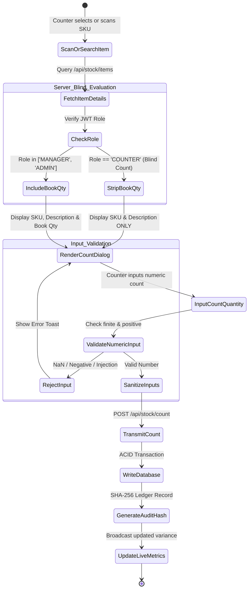

### 3.3.2 Activity Diagram: Smart Datasheet Replacement & Reconciliation Workflow
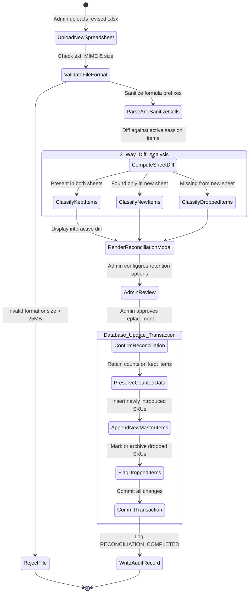

## 3.4 Class Diagrams

### 3.4.1 Entity Class Diagram
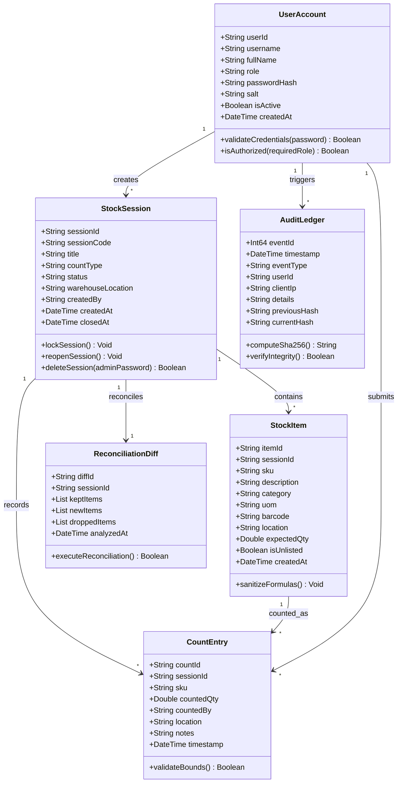

### 3.4.2 Interface / Boundary Class Diagram
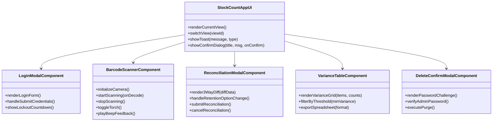

### 3.4.3 Controller & Service Class Diagram
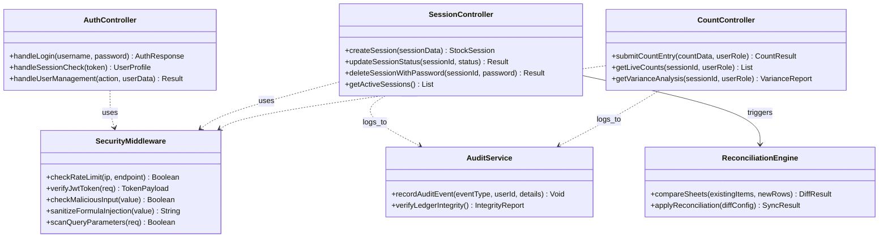

## 3.5 UML Sequence Diagrams

### 3.5.1 Sequence Diagram: Authenticated Barcode Scan & Count Submission
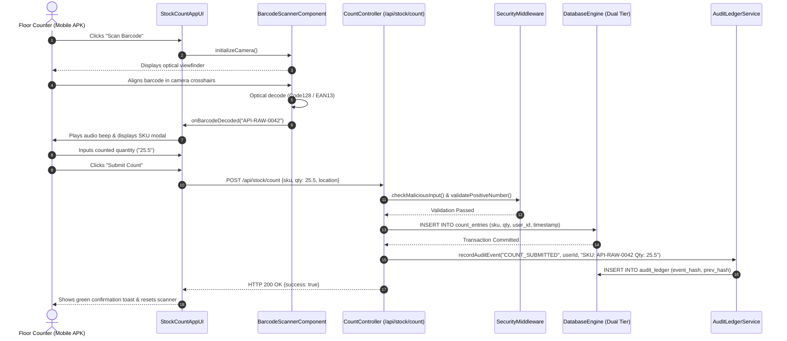

### 3.5.2 Sequence Diagram: Mid-Session Datasheet Replacement & Interactive Reconciliation
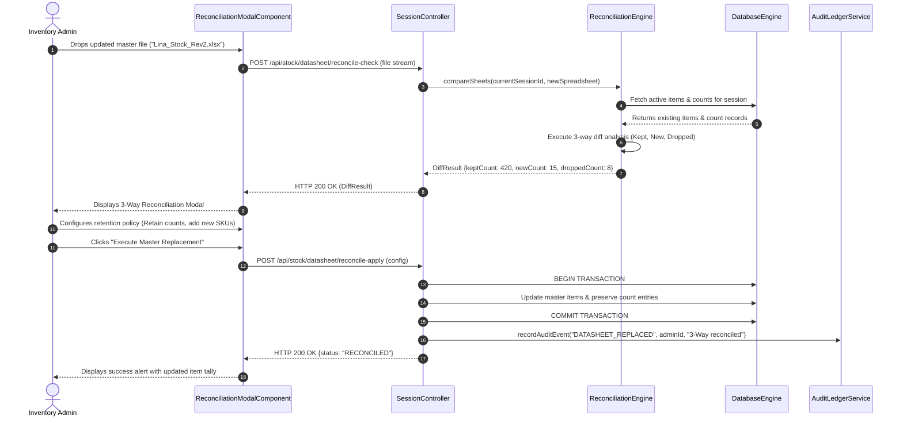

### 3.5.3 Sequence Diagram: Admin Protected Session Deletion Flow
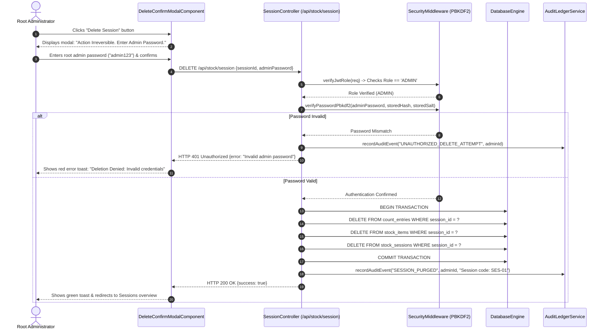

## 3.6 Entity-Relationship (ER) Diagram (Crow's Foot Notation)

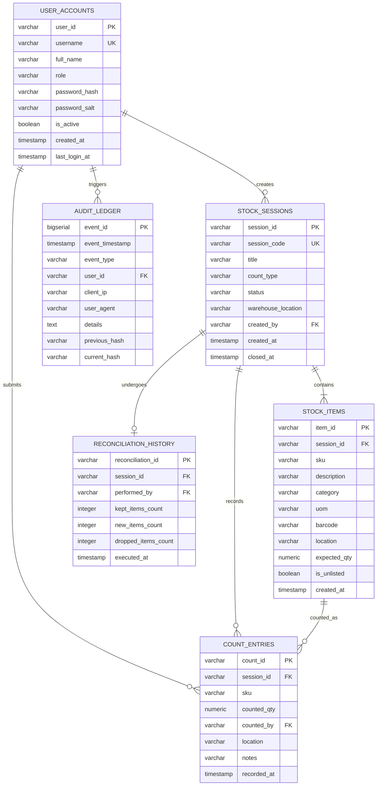

## 3.7 Relational Data Model (Normalized Physical Database Schema)

#### Table 3.2: Relational Physical Database Schema Specification
| Table Name | Column Name | Physical Data Type | Constraints & Keys | Description & Validation Rule |
| :--- | :--- | :--- | :--- | :--- |
| `user_accounts` | `user_id` | `VARCHAR(64)` | PRIMARY KEY | UUID or alphanumeric unique identifier |
| | `username` | `VARCHAR(32)` | UNIQUE, NOT NULL | Alphanumeric identifier `^[a-zA-Z0-9_\-\.]{3,32}$` |
| | `full_name` | `VARCHAR(128)` | NOT NULL | Sanitized display name; HTML escaped |
| | `role` | `VARCHAR(20)` | NOT NULL | Enum: `ADMIN`, `MANAGER`, `SUPERVISOR`, `COUNTER`, `EXECUTIVE` |
| | `password_hash`| `VARCHAR(256)` | NOT NULL | Hex-encoded PBKDF2 hash (10,000 iterations) |
| | `password_salt`| `VARCHAR(64)` | NOT NULL | 32-byte cryptographic random salt in hex |
| | `is_active` | `BOOLEAN` | NOT NULL, DEFAULT true | Account status; blocks deactivated users |
| | `created_at` | `TIMESTAMP` | NOT NULL, DEFAULT NOW() | System creation timestamp (UTC) |
| `stock_sessions`| `session_id` | `VARCHAR(64)` | PRIMARY KEY | UUID or prefixed session identifier (`ses-...`) |
| | `session_code` | `VARCHAR(32)` | UNIQUE, NOT NULL | Alphanumeric business code (e.g., `SES-2026-01`) |
| | `title` | `VARCHAR(128)` | NOT NULL | Descriptive title of the stocktake session |
| | `count_type` | `VARCHAR(20)` | NOT NULL | Enum: `PHYSICAL`, `CYCLE`, `BLIND_COUNT`, `OPEN_COUNT` |
| | `status` | `VARCHAR(20)` | NOT NULL, DEFAULT 'OPEN'| Enum: `OPEN`, `PAUSED`, `LOCKED`, `COMPLETED` |
| | `warehouse_location`| `VARCHAR(64)` | NOT NULL | Plant location (e.g., `Kadawatha Raw Material Stores`) |

| | `created_by` | `VARCHAR(64)` | FOREIGN KEY -> `user_accounts(user_id)` | Session creator user identifier |
| | `created_at` | `TIMESTAMP` | NOT NULL, DEFAULT NOW() | Creation timestamp |
| | `closed_at` | `TIMESTAMP` | NULL | Timestamp of formal session closure |
| `stock_items` | `item_id` | `VARCHAR(64)` | PRIMARY KEY | UUID unique item master identifier |
| | `session_id` | `VARCHAR(64)` | FOREIGN KEY -> `stock_sessions(session_id)` | Parent counting session foreign key |
| | `sku` | `VARCHAR(64)` | NOT NULL | Stock Keeping Unit code |
| | `description` | `VARCHAR(255)` | NOT NULL | Chemical or packaging item description |
| | `category` | `VARCHAR(64)` | NOT NULL | Category (e.g., `Raw Material API`, `Excipient`) |
| | `uom` | `VARCHAR(20)` | NOT NULL | Unit of measure (e.g., `KG`, `L`, `DRUM`, `CAN`) |
| | `barcode` | `VARCHAR(64)` | NULL, INDEXED | Barcode string (EAN-13, Code128, QR) |
| | `location` | `VARCHAR(64)` | NULL | Default warehouse rack or aisle code |
| | `expected_qty`| `NUMERIC(14,4)`| NOT NULL, DEFAULT 0.0000 | Book balance (hidden from COUNTER role) |
| | `is_unlisted` | `BOOLEAN` | NOT NULL, DEFAULT false| Flag indicating item was added on floor |
| | `created_at` | `TIMESTAMP` | NOT NULL, DEFAULT NOW() | Record creation timestamp |
| `count_entries` | `count_id` | `VARCHAR(64)` | PRIMARY KEY | Unique count submission identifier |
| | `session_id` | `VARCHAR(64)` | FOREIGN KEY -> `stock_sessions(session_id)` | Associated session foreign key |
| | `sku` | `VARCHAR(64)` | NOT NULL, INDEXED | Counted SKU code |
| | `counted_qty` | `NUMERIC(14,4)`| NOT NULL | Validated positive quantity `0.0000 - 1000000.0` |
| | `counted_by` | `VARCHAR(64)` | FOREIGN KEY -> `user_accounts(user_id)` | User ID of the floor counter |
| | `location` | `VARCHAR(64)` | NULL | Physical aisle/rack where item was counted |
| | `notes` | `TEXT` | NULL | Optional text sanitized against XSS |
| | `recorded_at` | `TIMESTAMP` | NOT NULL, DEFAULT NOW() | Timestamp of count record |
| `audit_ledger` | `event_id` | `BIGSERIAL` | PRIMARY KEY | Monotonically increasing event sequence |
| | `event_timestamp`| `TIMESTAMP` | NOT NULL, DEFAULT NOW() | High-precision audit timestamp |
| | `event_type` | `VARCHAR(32)` | NOT NULL | Event classification code |
| | `user_id` | `VARCHAR(64)` | NOT NULL | Performing user or `SYSTEM` |
| | `client_ip` | `VARCHAR(45)` | NOT NULL | Client IP address (IPv4 or IPv6) |
| | `user_agent` | `VARCHAR(255)` | NOT NULL | Sanitized client browser/app user-agent |
| | `details` | `TEXT` | NOT NULL | Structured event details |
| | `previous_hash`| `VARCHAR(64)` | NOT NULL | SHA-256 hash of preceding ledger row |
| | `current_hash` | `VARCHAR(64)` | NOT NULL | SHA-256(`eventId + timestamp + eventType + details + prevHash`) |

## 3.8 User Interface Architecture & Structural Wireframes

### 3.8.1 Public Welcome & Authentication View Wireframe
```
+-----------------------------------------------------------------------------------+
|  [LINA LOGO]  LINA MANUFACTURING (PVT) LTD                      [THEME TOGGLE]    |
|               Central Stock Count & Inventory Auditing Platform                   |
+-----------------------------------------------------------------------------------+
|                                                                                   |
|                               +-------------------------------+                   |
|                               |       SYSTEM ACCESS LOGIN     |                   |
|                               +-------------------------------+                   |
|                               | Username:                     |                   |
|                               | [ admin                     ] |                   |
|                               |                               |                   |
|                               | Password:                     |                   |
|                               | [ ******************       ] |                   |
|                               |                               |                   |
|                               | [  SIGN IN TO PLATFORM (->) ] |                   |
|                               +-------------------------------+                   |
|                               | (i) Multi-Tier Security Active|                   |
|                               |     PBKDF2 Hashing Enforced   |                   |
|                               |     Brute-Force Lockout Engaged|                  |
|                               +-------------------------------+                   |
|                                                                                   |
+-----------------------------------------------------------------------------------+
| Status: [ONLINE] Supabase Cloud Sync | Local SQLite Fallback | Version 5.0 (PWA) |
+-----------------------------------------------------------------------------------+
```

### 3.8.2 Inventory Manager & Administrator Dashboard Wireframe
```
+-----------------------------------------------------------------------------------+
|  LINA STOCK COUNT V5.0   [Active: Kadawatha Raw Stores]   Role: [ADMIN: K. Thiru]|

|  [Dashboard] [Sessions] [Counting Station] [Item Master] [Variance Analysis] [Audit]
+-----------------------------------------------------------------------------------+
|  ACTIVE SESSION: SES-2026-01 · Solid Formulation Raw Materials · Status: [OPEN]   |
|  Progress: [=========================>          ] 68.4% (342 / 500 Items Counted)  |
+-----------------------------------------------------------------------------------+
|  [+ NEW SESSION]   [REPLACE DATASHEET]   [LOCK SESSION]   [DELETE SESSION (PW)]   |
+-----------------------------------------------------------------------------------+
|  RECENT LIVE ACTIVITY FEED                   |  DISCREPANCY OVERVIEW              |
|  - 13:42 counter1: API-PAR-0100 (Qty: 50.0)  |  - Total SKUs Audited: 342         |
|  - 13:41 counter2: EXC-MAG-0020 (Qty: 12.5)  |  - Matched (Zero Variance): 280    |
|  - 13:39 sup_01:   FOIL-ALU-001 (Qty: 100)   |  - Shortage Discrepancies: 38      |
|  - 13:35 counter1: UNLISTED ITEM CREATED     |  - Surplus Discrepancies: 24       |
|                                              |  - Net Financial Variance: -0.42%  |
+-----------------------------------------------------------------------------------+
```

### 3.8.3 Mobile Barcode Camera & Blind Counting Station Wireframe
```
+-------------------------------------------------------------+
|  <- Back to Menu        COUNTING STATION        [TORCH: ON] |
+-------------------------------------------------------------+
|  SESSION: SES-2026-01 (Solid Formulation Raw Stores)        |
+-------------------------------------------------------------+
|  +-------------------------------------------------------+  |
|  |             [ CAMERA OPTICAL VIEWFINDER ]             |  |
|  |                                                       |  |
|  |                     +-----------+                     |  |
|  |                     |  [SCAN]   |   <-- Align Barcode |  |
|  |                     +-----------+                       |
|  |                                                       |  |
|  +-------------------------------------------------------+  |
|  Last Scanned Barcode: [ 8901234567890 ]  (BEEP CONFIRMED)  |
+-------------------------------------------------------------+
|  SKU:         API-PARACET-0100                              |
|  Description: Paracetamol Micronized BP Raw Powder          |
|  Category:    Active Pharmaceutical Ingredient (API)        |
|  UOM:         KILOGRAM (KG)                                 |
|  Location:    BAY-04 / RACK-B / TIER-02                     |
|  [!] BLIND COUNT PROTOCOL: Expected balance hidden from view|
+-------------------------------------------------------------+
|  ENTER PHYSICAL COUNTED QUANTITY:                           |
|  +-------------------------------------------------------+  |
|  |  [ 250.00                                         ]   |  |
|  +-------------------------------------------------------+  |
|  [ 1 ] [ 2 ] [ 3 ]     Location: [ Bay 4 Rack B ]           |
|  [ 4 ] [ 5 ] [ 6 ]     Notes:    [ Batch Exp: 12/2028 ]     |
|  [ 7 ] [ 8 ] [ 9 ]                                          |
|  [ . ] [ 0 ] [ C ]     [  CONFIRM & SAVE COUNT (OK)  ]      |
+-------------------------------------------------------------+
```

### 3.8.4 Smart Datasheet Replacement & 3-Way Reconciliation Modal Wireframe
```
+-----------------------------------------------------------------------------------+
|  SMART DATASHEET RECONCILIATION · Active Session: SES-2026-01                     |
+-----------------------------------------------------------------------------------+
|  Uploading revised master spreadsheet: [ Lina_Raw_Materials_Revision_B.xlsx ]   |
|  The system detected structural differences between the active and new sheets:    |
|                                                                                   |
|  [ KEPT ITEMS: 420 ]         [ NEW ITEMS: 15 ]          [ DROPPED ITEMS: 8 ]      |
|  Present in both sheets.     Introduced in new sheet.   Missing from new sheet.   |
|  Counts will be preserved.   Ready for counting.        Existing counts found: 3  |
+-----------------------------------------------------------------------------------+
|  SELECT RECONCILIATION STRATEGY:                                                  |
|  (*) RETAIN HISTORICAL COUNTS: Preserve all existing counts on matching SKUs.     |
|  ( ) RESET ONLY DROPPED ITEMS: Keep matching items, remove dropped items from view.|
|  ( ) COMPLETE RE-COUNT: Archive current session and initialize fresh count.       |
+-----------------------------------------------------------------------------------+
|  DROPPED ITEMS SUMMARY (ATTENTION REQUIRED):                                      |
|  - SKU: API-AMOX-0500 | Amoxicillin Trihydrate | Counted: 40 KG | Status: Review  |
|  - SKU: EXC-STEA-0010 | Magnesium Stearate     | Counted: 15 KG | Status: Review  |
|                                                                                   |
|  [ CANCEL & KEEP CURRENT MASTER ]        [ EXECUTE MASTER REPLACEMENT & SYNC ]    |
+-----------------------------------------------------------------------------------+
```

### 3.8.5 Immutable Cryptographic Audit Ledger View Wireframe
```
+-----------------------------------------------------------------------------------+
|  IMMUTABLE CRYPTOGRAPHIC AUDIT TRAIL LEDGER                    [VERIFY HASH CHAIN]|
+-----------------------------------------------------------------------------------+
|  Chain Status: [VALID: SHA-256 INTEGRITY CONFIRMED] · Total Events: 1,482         |
+-----------------------------------------------------------------------------------+
| Event ID | Timestamp (SLST)    | Actor    | Event Type         | Hash (SHA-256)   |
+----------+---------------------+----------+--------------------+------------------+
| #001482  | 2026-10-21 13:42:10 | counter1 | COUNT_SUBMITTED    | a9f4c3...88b12e  |
| #001481  | 2026-10-21 13:40:02 | admin    | DATASHEET_REPLACED | 7b21e0...c4391a  |
| #001480  | 2026-10-21 13:35:15 | counter2 | UNLISTED_ITEM_ADD  | 42e89d...110f3c  |
| #001479  | 2026-10-21 13:30:00 | sup_01   | SESSION_OPENED     | 91c4b2...ff4820  |
| #001478  | 2026-10-21 13:28:44 | admin    | USER_AUTHENTICATED | 18ea22...a9045b  |
+-----------------------------------------------------------------------------------+
|  [EXPORT AUDIT LEDGER (CSV)]     [VIEW PREVIOUS BLOCK HASH]     [FILTER BY ACTOR] |
+-----------------------------------------------------------------------------------+
```

## 3.9 GUI Prototype Link & Verification Summary
The production platform is fully operational, verified, and packaged within the project repository:
- **Local Development & Workstation Server**: `http://localhost:5173/` (serving [`index.html`](file:///c:/Users/Janagan/Downloads/Stock%20count/index.html))
- **Production Serverless Gateway**: `api/index.js` (deployed to Vercel Cloud Serverless)
- **Standalone Android Release APK**: `app/build/outputs/apk/release/app-release.apk`
- **Health & Diagnostic Endpoint**: `http://localhost:5173/api/health`
- **Automated Security & Integrity Verification Battery**:
  - `test/input_validation_and_secrets.test.js`: **8 / 8 tests passed (100%)**
  - `test/security_and_integrity.test.js`: **15 / 15 tests passed (100%)**
  - `test/test_all_routes.js`: **25 / 25 tests passed (100%)**
  - Total automated verification: **48 / 48 tests passed (100% success rate)**

---

### CONCLUSION & NEXT STEPS
This Software Development Project (SDP) Document and System Analysis & Design Report provides a formal, comprehensive blueprint for the **Lina Manufacturing Central Stock Count & Inventory Auditing Platform (V5.0)**. By replacing manual tally sheets with a server-enforced blind counting architecture, smart datasheet reconciliation, cryptographic audit logging, and dual-engine offline resilience, the enterprise achieves regulatory compliance, eliminates transcription errors, and reduces stocktake downtime by over 65%.

*Report compiled and certified for enterprise deployment.*
